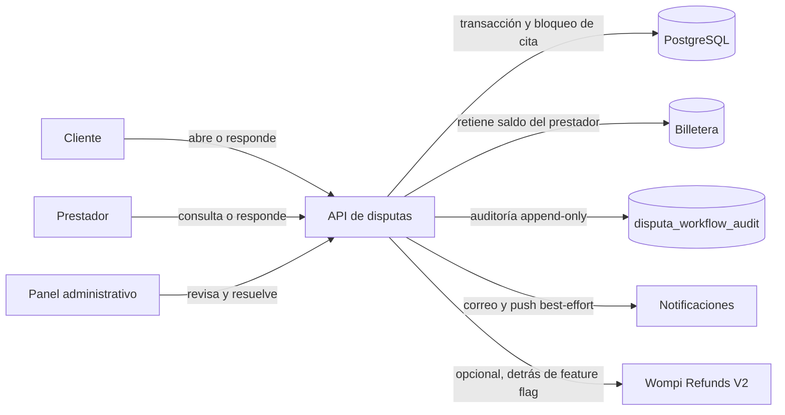

# Arquitectura de disputas de servicio GlowApp

## Flujo implementado

El expediente financiero es `disputas`; la conversación compartida y las notas privadas se guardan en `disputa_mensajes`. La apertura bloquea la fila de la cita, comprueba que no haya otro caso activo y retiene el saldo disponible del prestador en la misma transacción. Cliente y prestador pueden consultar el caso y responder; sus mensajes son visibles para ambas partes. Las notas `INTERNA` permanecen solo en la bandeja administrativa.

## Estados y decisiones

- El caso nace en `ABIERTA`, puede pasar a `EN_REVISION` y termina en `RESUELTA` o `CERRADA`.
- La resolución mueve el saldo retenido en una transacción y guarda quién decidió, el motivo, los importes y el resultado en la bitácora inmutable.
- El estado del reembolso es independiente: `PENDIENTE`, `PROCESANDO`, `COMPLETADO`, `FALLIDO` o `NO_APLICA`. Una decisión registrada no se presenta como reembolso pagado hasta recibir confirmación del proveedor de pagos.
- La apertura está limitada a citas `COMPLETADA` y a motivos compatibles con ese estado: el modelo de fondos actual solo tiene una ruta segura para retener y liberar ese saldo. Las reclamaciones por inasistencia necesitan una ruta financiera separada antes de habilitarse.
- El cliente solo puede abrir el caso dentro de `disputa_ventana_horas` (48 h por defecto, configurable).

## Rutas de aplicación

| Método y ruta | Uso y autorización |
|---|---|
| `POST /api/disputes` | Cliente o prestador participante abre el expediente. `POST /api/disputas` se conserva como alias compatible. |
| `GET /api/disputes/my-disputes` | Lista los casos donde el usuario es una de las partes. |
| `GET /api/disputes/:id` | Devuelve el expediente y solo mensajes `PARTES`; requiere ser cliente o prestador de la cita. |
| `POST /api/disputes/:id/messages` | Agrega una respuesta compartida y notifica a la otra parte si hay canales configurados. |
| `GET /api/admin/disputes/:id/review` | Vista administrativa del expediente, incluidos mensajes internos. |
| `POST /api/admin/disputes/:id/messages` | Agrega respuesta `PARTES` o nota `INTERNA`; la respuesta compartida notifica a las partes. |
| `PUT /api/admin/disputes/:id/resolve` | Resolución financiera transaccional. La ruta histórica `PATCH` ya no modifica solo el estado. |

Los clientes abren casos desde una cita seleccionada en la aplicación, sin escribir el identificador manualmente. El panel muestra las evidencias Base64 existentes y el estado separado del reembolso. El prestador accede a su bandeja desde el centro de soporte y puede consultar el detalle, responder y adjuntar evidencia.

## Evidencias y notificaciones

Las rutas validan hasta cinco imágenes por envío, solo JPEG/PNG/WebP, máximo 1,5 MB por imagen y 7,5 MB en total. Las evidencias se guardan como `data URI` Base64 en PostgreSQL para compatibilidad con los datos existentes; la bitácora registra que hubo adjuntos, su cantidad y el mensaje asociado, sin copiar el contenido de la imagen.

Los avisos de correo y push son best-effort: no revierten una respuesta ni una resolución. El correo requiere `BREVO_API_KEY` o SMTP; la push requiere token FCM y cuenta de servicio. Los nuevos casos pueden avisar además a `SUPPORT_INBOX_EMAIL`.

## Despliegue y controles pendientes

1. Aplicar `migrations/186_disputas_workflow_audit.sql` antes de desplegar backend y apps que leen `evidencia_urls` de los mensajes.
2. Confirmar en el entorno que `app_system` tiene acceso al rol y secuencia de auditoría.
3. Configurar el correo y FCM si se esperan avisos. Revisar el registro de notificaciones fallidas.
4. `WOMPI_REFUNDS_V2_ENABLED` permanece `false`. La documentación pública de Wompi consultada describe el contrato V2 y sus escenarios de sandbox; antes de habilitar reembolsos en producción se debe validar disponibilidad/credenciales productivas, conciliación de respuestas y eventos, además de probar el flujo en sandbox.
5. La evidencia Base64 mantiene compatibilidad, pero aumenta el tamaño de la base de datos y las respuestas HTTP. La siguiente mejora de infraestructura es trasladarla a almacenamiento de objetos privado con URLs firmadas de corta duración y retención definida.
6. No se añadió una restricción única sobre disputas históricas: la apertura serializa por fila de cita para impedir concurrencia nueva sin hacer fallar la migración por duplicados antiguos. Revisar esos duplicados antes de imponer una garantía de base de datos.
