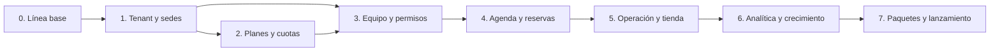

# Plan de desarrollo del SaaS GlowApp por fases

## Propósito

Unificar las capacidades SaaS y las operaciones del salón bajo un mismo contexto de negocio, permisos, planes y medición de uso. El resultado debe permitir vender módulos por escala sin que la oferta comercial contradiga lo que la aplicación realmente habilita.

Este documento es el plan de trabajo. No implica que las fases ya se hayan ejecutado. **Al cerrar cada fase, se debe crear su informe de cierre antes de iniciar la siguiente** con los cambios realizados, decisiones, verificación, riesgos y trabajo pendiente.

## Estado de ejecución

| Fase | Estado | Evidencia |
|---|---|---|
| 0 | Inventario realizado previamente | Contraste de arquitectura y decisiones documentadas durante el análisis. |
| 1 | Cerrada: desplegada y conciliada en producción el 23 de noviembre de 2026 | [Informe de Fase 1](fases/FASE_1_IDENTIDAD_TENANT_SEDES.md), migración 189; API sana y sin sedes huérfanas ni perfiles compartidos. |
| 2 | Cerrada: desplegada y comprobada en producción el 23 de noviembre de 2026 | [Informe de Fase 2](fases/FASE_2_CATALOGO_ENTITLEMENTS_CUOTAS.md). Catálogo v1 activo; Hosting proveedor, API y panel publicados. Pruebas de integración de cuotas y conciliación comercial quedan como pendientes identificados. |
| 3 | Cerrada: desplegada en producción el 23 de noviembre de 2026 | [Informe de Fase 3](fases/FASE_3_MEMBRESIAS_ROLES.md). Commit `a8e105f`; migración 190 aplicada; API responde 200 y Postgres está activo. Staging aún está en `65534a4` y no contiene fases 1–3. |
| 4 | En curso: implementación local el 23 de noviembre de 2026 | [Informe de Fase 4](fases/FASE_4_AGENDA_RESERVAS.md). Alcance de negocio/sede, horarios colombianos, concurrencia, selección de sede en cliente y agenda SaaS para miembros; reprogramación con colisiones serializadas. Staging diverge (17 commits propios y 125 detrás de `main`) y tiene cuatro cambios Railway pendientes. Requiere resolver esa línea base y validar en staging antes del cierre/despliegue. |
| 5 | En curso: implementación local directa para producción el 23 de noviembre de 2026 | [Informe de Fase 5](fases/FASE_5_OPERACION_COMERCIAL.md). Caja e inventario idempotentes, recetas por servicio, consumo al completar reserva y liberación de recursos; validación y publicación pendientes. Por instrucción expresa, esta fase omite staging. |
| 6–7 | Pendientes | Se iniciarán después del cierre de Fase 5. |

## Reglas de ejecución

1. Mantener la arquitectura actual como monolito modular; no separar servicios desplegables hasta que una necesidad de escala lo justifique.
2. Migrar gradualmente y conservar compatibilidad mientras las apps cliente y proveedor consumen los contratos existentes.
3. No cambiar ni eliminar datos históricos en una migración sin respaldo, estrategia de reversión y revisión de impacto.
4. Cada operación de negocio debe resolverse dentro de un `tenant_id` y, cuando aplique, una sede explícita.
5. La autorización y las cuotas deben tener una sola fuente de verdad en backend. Flutter puede presentar la información, pero no decidir el acceso.
6. No anunciar una capacidad comercial hasta que el flujo haya sido integrado y su límite pueda medirse y aplicarse.
7. Respetar cambios locales preexistentes; antes de editar una fase se revisará el estado del árbol de trabajo.

## Fases

| Fase | Nombre | Resultado principal | Dependencia |
|---|---|---|---|
| 0 | Línea base y decisiones | Inventario verificado, mapa de dependencias y contratos de migración | Ninguna |
| 1 | Identidad canónica de negocio y sedes | SaaS y salón apuntan a la misma identidad de tenant/sede | Fase 0 |
| 2 | Catálogo comercial, entitlements y cuotas | Una definición de planes, módulos, límites y medición | Fase 1 |
| 3 | Membresías, roles y permisos | Equipo SaaS y roles operativos unificados | Fases 1 y 2 |
| 4 | Agenda y reservas como módulo SaaS | Reservas asociadas y controladas por tenant/sede/plan | Fases 1–3 |
| 5 | Operación del salón | Caja, inventario, recursos y tienda integrados como módulos | Fases 1–3; reservas disponibles |
| 6 | Crecimiento y herramientas avanzadas | Analítica, fidelización, capacitación, diagnóstico e IA con alcance SaaS | Fases 1–5 |
| 7 | Paquetes comerciales y despliegue gradual | Planes por escala, onboarding coherente y salida controlada | Fases 1–6 |

---

## Fase 0 — Línea base, inventario y decisiones de arquitectura

### Alcance

- Trazar los flujos de aprovisionamiento SaaS, creación de salón, selección de negocio/sede, reservas, membresías, caja e inventario.
- Identificar todas las fuentes actuales de plan (`business_profiles`, `salones` u otras), roles, límites y comprobaciones de acceso.
- Clasificar rutas y servicios en: reutilizable directamente, requiere adaptador, requiere refactor, fuera de alcance comercial o pendiente de validación.
- Registrar los contratos API consumidos por Flutter y panel administrativo, junto con versiones de base de datos/migraciones relevantes.
- Acordar el modelo canónico de tenant, sede, membresía, rol, módulo y cuota antes de migrar datos.

### Entregables

- Mapa del estado actual y diagrama objetivo aprobado en documentación.
- Tabla de equivalencias de identificadores y roles.
- Inventario de riesgos y plan de compatibilidad/reversión.
- Decisión documentada de arquitectura para la identidad canónica.

### Criterios de cierre

- Cada flujo crítico tiene origen, tablas, rutas, guards y clientes identificados.
- Está claro cuál es el identificador estable del negocio y cómo se representa una sede.
- Las inconsistencias de planes, membresías y límites tienen propietario y resolución propuesta.

### Informe al cerrar

Crear `docs/fases/FASE_0_LINEA_BASE.md` con el mapa verificado, acuerdos, evidencia de inspección y asuntos que bloquean la fase 1.

---

## Fase 1 — Identidad canónica de negocio y sedes

### Alcance

- Definir `business_profile`/tenant como identidad comercial SaaS y definir explícitamente las sedes como entidades subordinadas.
- Convertir la relación actual entre `business_profiles` y `salones` en una relación explícita y única; dejar de depender de generar el ID del perfil como `salon-<id>` como mecanismo implícito de identidad.
- Asegurar que el negocio y la sede activos se seleccionen de manera explícita en sesión/contexto de petición.
- Integrar el contexto SaaS con el aislamiento PostgreSQL/RLS sin crear contextos divergentes.
- Migrar datos de forma idempotente, con reporte de filas no asociadas y procedimiento de rollback.

### Entregables

- Modelo y migración aditiva tenant-sede.
- Resolutor común de tenant y sede para middleware y repositorios.
- Adaptadores temporales para rutas antiguas mientras se migran.
- Observabilidad de fallos de asociación y guía de operación.

### Criterios de cierre

- El usuario con uno o varios salones puede seleccionar el negocio/sede correcto.
- Las consultas y escrituras no pueden cruzar tenants/sedes por cambiar IDs en la petición.
- No hay dos campos de plan o identidad que puedan contradecirse sin detección.
- Las rutas previas críticas siguen funcionando durante la transición.

### Informe al cerrar

Crear `docs/fases/FASE_1_IDENTIDAD_TENANT_SEDES.md`. Documentar el esquema final, migración ejecutada, filas conciliadas, decisiones de RLS, rutas adaptadas y reversión.

---

## Fase 2 — Catálogo comercial, entitlements y medición

### Alcance

- Crear una fuente declarativa versionada para productos, planes, módulos incluidos, cuotas, períodos y complementos.
- Unificar `saasEntitlements`, `usageMeteringService`, `usageTracker`, verificaciones de plan del salón y límites de asientos.
- Distinguir permisos booleanos (p. ej. POS) de cuotas medibles (reservas, integrantes, mensajes, API, almacenamiento).
- Dar nombres comerciales y descripciones legibles a las métricas; no presentar “llamadas API” como valor principal para un dueño de salón.
- Incorporar límites, contadores, período, idempotencia, alertas y reglas de sobreconsumo en el backend.
- Retirar el uso de una capacidad no relacionada —por ejemplo, `CUSTOM_BRANDING`— como sustituto de acceso API.

### Entregables

- Catálogo central de planes y módulos.
- Servicio único de autorización y servicio único de medición.
- Endpoint de catálogo para onboarding/comparación de planes.
- Proceso para notificar 80/100 % de cuota, cuando se permita en el plan.
- Plan de migración de los planes actuales y conciliación de discrepancias.

### Criterios de cierre

- Backend, onboarding y pantalla de uso derivan del mismo catálogo.
- Toda cuota vendida se mide y se aplica en las rutas pertinentes.
- Un plan no puede obtener una capacidad implícita por pertenecer a otro módulo.
- Cambiar de plan no borra historial ni permite elevar cuotas por cambiar datos enviados por el cliente.

### Informe al cerrar

Crear `docs/fases/FASE_2_CATALOGO_ENTITLEMENTS_CUOTAS.md` con matriz de planes, diferencias antes/después, rutas instrumentadas, conciliación y reglas de exceso.

---

## Fase 3 — Membresías, roles y permisos

### Alcance

- Elegir un único modelo de membresía y conectarlo a roles SaaS y roles operativos del salón.
- Mapear propietario, administrador, gerente, recepción, prestador, empleado y solo lectura a permisos concretos por módulo.
- Centralizar invitación, aceptación, reactivación, cambio de rol, baja y conteo de asientos.
- Asegurar que límites de integrantes incluyan de forma consistente miembros activos y pendientes.
- Enviar invitaciones usando el servicio de correo, eliminar tokens de invitación expuestos en respuestas de producción y registrar eventos auditables.

### Entregables

- Matriz RBAC por acción y módulo.
- Guardas comunes para rutas SaaS y rutas de salón.
- Flujo de invitación integrado y política de asientos.
- Compatibilidad temporal para roles heredados.

### Criterios de cierre

- Cada endpoint de escritura tiene permiso mínimo explícito y validado en backend.
- Cambiar rol, desactivar o retirar un miembro se refleja en ambas apps.
- El conteo de asientos coincide con el plan y con la interfaz.
- Las operaciones críticas quedan asociadas al usuario que las realizó.

### Informe al cerrar

Crear `docs/fases/FASE_3_MEMBRESIAS_ROLES.md` con la matriz RBAC, rutas migradas, tratamiento de roles heredados y verificaciones de aislamiento.

---

## Fase 4 — Agenda y reservas

### Alcance

- Integrar reservas, catálogo de servicios, horarios, disponibilidad y prestador con tenant y sede canónicos.
- Alinear reserva, reprogramación, cancelación, pago, no-show, comprobante y reseña con el mismo ciclo de vida.
- Aplicar cuotas de reservas desde el servicio central, definiendo qué evento cuenta y cómo se manejan cancelaciones/reintentos.
- Exponer reservas a clientes por los canales actuales sin duplicar los datos comerciales del proveedor.
- Definir recordatorios como módulo separado, con conteo de mensajes y costos externos transparentes.

### Entregables

- Contrato estable de agenda/reserva por sede.
- Adaptadores desde rutas actuales.
- Flujo de reserva trazable y estados normalizados.
- Medición de reservas y notificaciones vinculada a plan.

### Criterios de cierre

- No se puede reservar un servicio de otra sede/tenant mediante manipulación de IDs.
- La cuota es consistente entre creación de reservas, cancelaciones y métricas.
- El personal ve solo las citas autorizadas para su rol y alcance.
- Los cambios siguen siendo compatibles con la app cliente.

### Informe al cerrar

Crear `docs/fases/FASE_4_AGENDA_RESERVAS.md` con estados del ciclo, rutas migradas, reglas de cuota, excepciones y compatibilidad móvil.

---

## Fase 5 — Operación: caja, inventario, recursos y tienda

### Alcance

- Integrar caja, movimientos y constancias con la sede, roles y auditoría del núcleo.
- Conectar inventario con insumos, movimientos y consumos de servicios cuando la relación sea fiable.
- Incorporar recursos y alquileres con disponibilidad y responsable.
- Ofrecer tienda, pedidos, preparación, entrega y devoluciones como módulo de venta complementario.
- Determinar qué módulos son incluidos por plan y cuáles pueden contratarse por separado.
- Separar claramente la caja operativa del salón de la billetera y los desembolsos de GlowApp.

### Entregables

- Módulos operativos con permisos y auditoría comunes.
- Reglas para ajustes, anulaciones y reversos de dinero/inventario.
- Matriz de módulos por escala y dependencias de hardware/proveedores externos.

### Criterios de cierre

- Las operaciones financieras no se pueden duplicar o alterar desde reintentos sin idempotencia.
- Caja e inventario respetan alcance de sede y permisos.
- No se mezclan ventas del salón con liquidaciones o saldos de la plataforma.
- La tienda puede habilitarse para salones que tengan productos sin forzarla en todos los tenants.

### Informe al cerrar

Crear `docs/fases/FASE_5_OPERACION_COMERCIAL.md` documentando módulos habilitados, controles, reversos y dependencias externas.

---

## Fase 6 — Crecimiento y herramientas avanzadas

### Alcance

- Construir analítica de negocio sobre datos conciliados: reservas, ingresos, recurrencia, ocupación, equipo y productos.
- Separar analítica del salón de telemetría técnica y cuotas SaaS.
- Integrar fidelización/referidos con identidad del negocio y reglas transparentes para costo y recompensa.
- Evaluar Academia, diagnóstico empresarial y copiloto IA como complementos: cada recomendación debe respetar permisos, consentimiento y límites.
- Restringir acciones automáticas de IA; las acciones de impacto comercial (p. ej. cambiar precios) requieren confirmación explícita y registro.

### Entregables

- Indicadores con definición y fórmula documentadas.
- Complementos comerciales con límites y costos externos visibles.
- Controles de privacidad y acceso para datos personales, biométricos y comerciales.

### Criterios de cierre

- Cada indicador tiene fuente, período y fórmula reproducibles.
- Ningún informe mezcla tenants ni muestra datos de clientes fuera del permiso otorgado.
- IA no ejecuta cambios de precio, comunicación masiva o acciones financieras sin controles establecidos.
- Se identifica qué funciones son productivas y cuáles siguen siendo piloto.

### Informe al cerrar

Crear `docs/fases/FASE_6_CRECIMIENTO_ANALITICA_IA.md` con métricas, complementos, permisos, consentimiento, costos y estado de madurez.

---

## Fase 7 — Empaquetamiento comercial y salida gradual

### Escalas de producto objetivo

| Escala | Oferta | Módulos candidatos |
|---|---|---|
| Independiente | Tener presencia y gestionar las citas propias | Vitrina, servicios, agenda, reservas y clientes básicos |
| Salón pequeño | Coordinar un equipo y la operación diaria | Independiente + equipo/roles, caja e inventario básico |
| Salón en crecimiento | Aumentar ventas y entender resultados | Salón pequeño + analítica, tienda, fidelización y automatizaciones disponibles |
| Empresa / varias sedes | Controlar varias sedes y conectar sistemas | Crecimiento + multi-sede, reportes consolidados, API/integraciones y soporte con SLA definido |

La tabla es la estructura objetivo; los módulos no deben anunciarse hasta que las fases anteriores demuestren su funcionamiento completo.

### Alcance

- Definir nombres de planes en lenguaje de salón, capacidad incluida, límites, precio y condiciones de excedente.
- Mostrar en onboarding los límites de prueba/gratis y explicar el impacto de alcanzarlos.
- Hacer que el catálogo de la interfaz se obtenga desde backend.
- Diseñar migración de clientes actuales, período de transición y política de cambio de plan.
- Activar primero con tenants internos/piloto, medir errores y luego ampliar gradualmente.
- Preparar rollback de flags y versión anterior de contratos antes de despliegue general.

### Entregables

- Tabla comercial final y copy de onboarding.
- Guía para migrar plan, activar módulo y atender sobreconsumo.
- Plan de despliegue progresivo, métricas de salud y rollback.

### Criterios de cierre

- El texto comercial coincide con catálogo, backend, cobro y UI.
- El proveedor puede entender qué incluye su plan y qué ocurre al llegar al límite.
- El piloto no muestra contaminación de datos ni divergencias de permisos/cuotas.
- Existe una forma de detener o revertir el despliegue sin pérdida de operación.

### Informe al cerrar

Crear `docs/fases/FASE_7_PAQUETES_Y_LANZAMIENTO.md` con oferta aprobada, resultados del piloto, incidencias, cambios y decisión de ampliación.

---

## Plantilla obligatoria para el cierre de cada fase

Cada informe `docs/fases/FASE_N_*.md` debe incluir:

1. **Objetivo y alcance ejecutado** — qué quedó dentro y qué se pospuso.
2. **Qué se hizo** — archivos, módulos, rutas, contratos, datos y migraciones modificados.
3. **Cómo funciona ahora** — explicación funcional para producto y explicación técnica breve.
4. **Decisiones tomadas** — alternativas relevantes y motivo de elección.
5. **Verificación** — comandos/escenarios ejecutados y resultados; no declarar verificado lo que no se ejecutó.
6. **Datos y despliegue** — migraciones, flags, compatibilidad y pasos operativos.
7. **Riesgos y rollback** — impactos conocidos y procedimiento de reversión.
8. **Pendientes y fase siguiente** — trabajo excluido y dependencias abiertas.

Al cerrar cada fase, actualizar también este plan con estado `Completada`, `En curso` o `Pendiente`, fecha y enlace al informe. Solo se inicia la fase siguiente después de documentar el cierre de la fase actual.

## Secuencia resumida de dependencias

