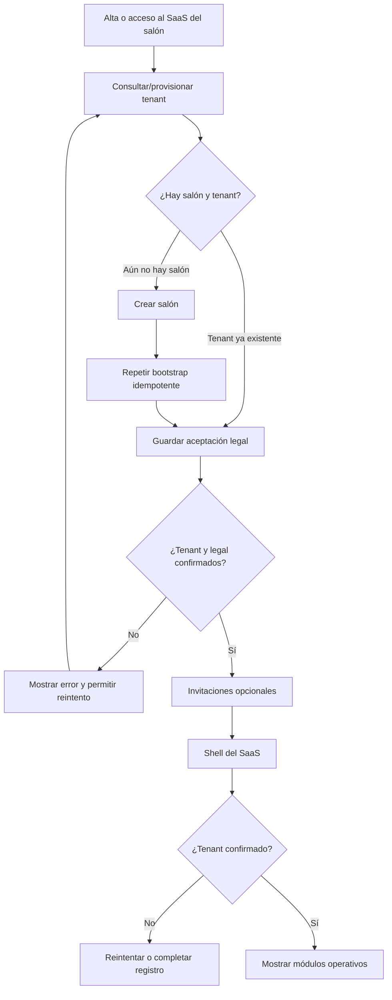

# Onboarding SaaS — Fase 1: puerta de entrada

**Estado:** publicada en producción; validación automatizada aprobada. Pendiente revisión funcional de los flujos con cuentas reales.
**Fecha:** 24 de noviembre de 2026.

## Objetivo

Impedir que el onboarding o una ruta directa de la app permitan operar el SaaS del salón sin un tenant SaaS confirmado. Permitir reintentar una provisión fallida aprovechando el bootstrap idempotente.

## Cambios realizados

- El alta de salón consulta primero el bootstrap SaaS. Solo intenta crear el salón cuando el backend confirma que el usuario aún no tiene uno.
- Tras crear el salón, vuelve a ejecutar el bootstrap idempotente. Si la respuesta del alta se perdió después de guardar el salón, se recupera el tenant existente en vez de insertar otro salón.
- Se eliminó la salida que completaba el onboarding y llevaba al hub sin tenant.
- La aceptación legal se guarda después de confirmar la provisión SaaS. Si falla, el usuario permanece en el formulario y puede reintentar sin recrear el salón.
- Los errores de provisión se muestran como bloqueos recuperables; las invitaciones siguen siendo opcionales y no bloquean la entrada.
- El shell `/salon` comprueba/provisiona el tenant antes de renderizar sus módulos. Si no puede, muestra reintento y acceso al formulario.
- La ruta directa `/salon/caja` reutiliza el shell y pasa por el mismo control de entrada.

## Flujo actualizado

## Validación y estado de publicación

- La suite de análisis y pruebas del proveedor pasó en GitHub Actions (workflow de verificación previa `45335504674`).
- El build web del proveedor pasó en el workflow de publicación `45336126415`.
- El deploy del job `Deploy glow_provider` terminó con éxito el 24 de noviembre de 2026.
- Producción: [GlowApp Proveedor](https://glowapp-provider.web.app/#/auth/onboarding). La raíz respondió HTTP 200 y el bundle servido contiene los textos de preparación SaaS y recuperación del registro.
- Código integrado en `main` mediante [PR #52](https://github.com/Diegoromerov/glowapp-firebase/pull/52), commit `34f8d185fa09ec4afec8a5c674e1a239af033371`.
- El análisis local no reportó errores de Dart; los diagnósticos restantes eran lint/estilo y deprecaciones.

## Pendiente para cerrar la fase

1. Revisar en producción el alta nueva, el reintento tras una respuesta perdida, la cuenta con tenant existente, el usuario sin salón y el acceso directo a Caja.
2. Confirmar con una cuenta heredada que el bootstrap recupera tenant/salón sin alterar el plan existente.
3. Corregir y volver a desplegar solo si la revisión funcional encuentra incompatibilidades.
