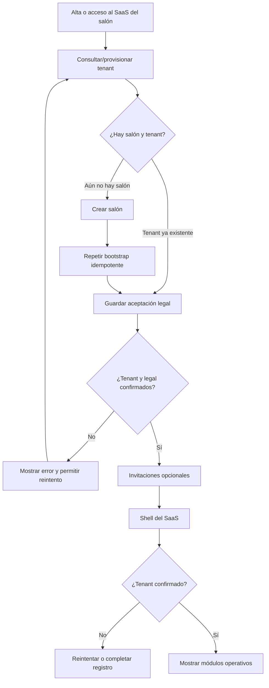

# Onboarding SaaS — Fase 1: puerta de entrada

**Estado:** implementada en el worktree; pendiente de validación funcional y publicación.
**Fecha:** 24 de noviembre de 2026.

## Objetivo

Impedir que el onboarding o una ruta directa de la app permitan operar el SaaS del salón sin un tenant SaaS confirmado. Permitir reintentar una provisión fallida aprovechando el bootstrap idempotente.

## Cambios realizados

- El alta de salón consulta primero el bootstrap SaaS. Solo intenta crear el salón cuando el backend confirma que el usuario aún no tiene uno.
- Tras crear el salón, vuelve a ejecutar el bootstrap idempotente. Si la respuesta del alta se perdió después de guardar el salón, se recupera el tenant existente en vez de insertar otro salón.
- Se eliminó la salida que completaba el onboarding y llevaba al hub sin tenant.
- La aceptación legal se guarda después de confirmar la provisión SaaS. Si falla, el usuario permanece en el formulario y puede reintentar sin recrear el salón.
- Los errores de provisión se muestran como bloqueos recuperables; las invitaciones siguen siendo opcionales y no bloquean la entrada.
- El shell `/salon` comprueba/provisiona el tenant antes de renderizar sus módulos. Si no puede, muestra reintento y acceso al formulario.
- La ruta directa `/salon/caja` reutiliza el shell y pasa por el mismo control de entrada.

## Flujo actualizado

## Validación y estado de publicación

- `git diff --check` pasó sin errores de whitespace.
- Se revisó el flujo y los contratos existentes de `createSalon`, `saas/bootstrap`, aceptación legal y rutas del shell.
- `flutter analyze --no-pub` sobre los tres archivos Flutter no reportó errores; sí reportó diagnósticos de lint/estilo y deprecación (84 en total).
- No se ejecutaron pruebas funcionales automatizadas.
- No se desplegó a producción. La fase requiere validación funcional del alta nueva, reintento después de una respuesta perdida, cuenta con tenant existente, usuario sin salón y acceso directo a Caja antes de publicar.

## Pendiente para cerrar la fase

1. Ejecutar las pruebas funcionales de esos escenarios en un entorno autorizado.
2. Corregir cualquier incompatibilidad observada y validar el flujo en web/móvil según aplique.
3. Publicar en producción cuando la validación sea satisfactoria y actualizar este informe con la revisión desplegada y evidencia.
