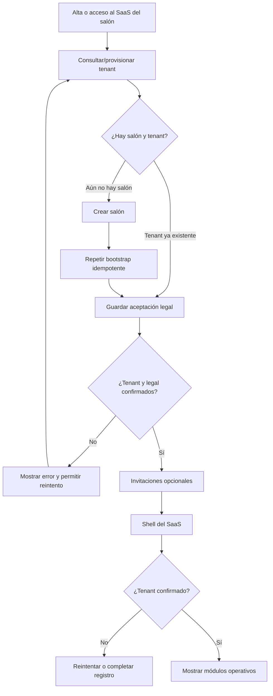

# Onboarding SaaS — Fase 1: puerta de entrada

**Estado:** correcciones publicadas en producción; validación automatizada y health de API aprobados. Pendiente prueba funcional de onboarding con una cuenta de QA controlada.
**Fecha:** 24 de noviembre de 2026.

## Objetivo

Impedir que el onboarding o una ruta directa de la app permitan operar el SaaS del salón sin un tenant SaaS confirmado. Permitir reintentar una provisión fallida aprovechando el bootstrap idempotente.

## Cambios realizados

- El alta de salón consulta primero el bootstrap SaaS. Solo intenta crear el salón cuando el backend confirma que el usuario aún no tiene uno.
- Tras crear el salón, vuelve a ejecutar el bootstrap idempotente. Si la respuesta del alta se perdió después de guardar el salón, se recupera el tenant existente en vez de insertar otro salón.
- Se eliminó la salida que completaba el onboarding y llevaba al hub sin tenant.
- La aceptación legal se guarda después de confirmar la provisión SaaS. Si falla, el usuario permanece en el formulario y puede reintentar sin recrear el salón.
- Los errores de provisión se muestran como bloqueos recuperables; las invitaciones siguen siendo opcionales y no bloquean la entrada.
- El shell `/salon` comprueba/provisiona el tenant antes de renderizar sus módulos. Si no puede, muestra reintento y acceso al formulario.
- La ruta directa `/salon/caja` reutiliza el shell y pasa por el mismo control de entrada.

## Flujo actualizado

## Validación y estado de publicación

- La suite de análisis y pruebas del proveedor pasó en GitHub Actions (workflow de verificación previa `45335504674`).
- El build web del proveedor pasó en el workflow de publicación `45336126415`.
- El deploy del job `Deploy glow_provider` terminó con éxito el 24 de noviembre de 2026.
- Producción: [GlowApp Proveedor](https://glowapp-provider.web.app/#/auth/onboarding). La raíz respondió HTTP 200 y el bundle servido contiene los textos de preparación SaaS y recuperación del registro.
- Código integrado en `main` mediante [PR #52](https://github.com/Diegoromerov/glowapp-firebase/pull/52), commit `34f8d185fa09ec4afec8a5c674e1a239af033371`.
- La recuperación de salones heredados conserva el plan válido de `salones.plan_saas`, aunque la app reintente enviando `FREE_TRIAL`; los planes heredados desconocidos se bloquean con conflicto explícito en vez de degradar la cuenta. Incluido en [PR #54](https://github.com/Diegoromerov/glowapp-firebase/pull/54), commit `c971e1005a90c665dba3f99b2fc108868a7c8785`.
- Las pruebas de ruta para conservar el plan y rechazar un código legado desconocido pasaron localmente y en el workflow Backend CI `45337648205`.
- Railway production: despliegue `15eb7a51-2af3-4ff7-b75f-39c5cb6addd1` terminó en `SUCCESS` para el commit `c971e10`. `/api/health` respondió HTTP 200, reportó PostgreSQL disponible y `servingFabricatedData: false`; `/api/saas/bootstrap` devuelve HTTP 401 sin credenciales.
- Se corrigió el caso en que el registro dejaba un `business_profile` preliminar sin salón: `findTenant` ahora exige que el perfil tenga una sede asociada, para que el onboarding pueda crear el salón en vez de saltar al shell sin sede. Incluido en [PR #56](https://github.com/Diegoromerov/glowapp-firebase/pull/56), commit `9a0d9df2bf59bb7723449b9fff565f0c249aa548`.
- La CI de PR #56 completó con éxito sintaxis, pruebas dirigidas, verificaciones RLS/aislamiento, contrato API e integración con PostgreSQL (`45338674240`). La suite dirigida local pasó 9/9.
- Railway production desplegó `9d4f6c44-55bc-479e-8ec2-c196d2e5f3af` en `SUCCESS` para `9a0d9df`. Verificación posterior: `/api/health` respondió HTTP 200, `env=production`, commit `9a0d9df2bf59bb7723449b9fff565f0c249aa548`, PostgreSQL disponible, `servingFabricatedData=false`, `memoryFallbackAllowed=false`; `/api/saas/bootstrap` sin token respondió 401.
- El análisis local no reportó errores de Dart; los diagnósticos restantes eran lint/estilo y deprecaciones.

## Pendiente para cerrar la fase

1. Ejecutar con una cuenta de QA controlada en producción el alta nueva, el reintento tras una respuesta perdida, la cuenta con tenant existente, el usuario sin salón y el acceso directo a Caja.
2. Confirmar con una cuenta heredada de QA que el bootstrap recupera tenant/salón sin alterar el plan existente.
3. Cerrar la fase cuando se hayan revisado los flujos de extremo a extremo en navegador; no se crearon cuentas, salones ni invitaciones de prueba durante esta validación.
