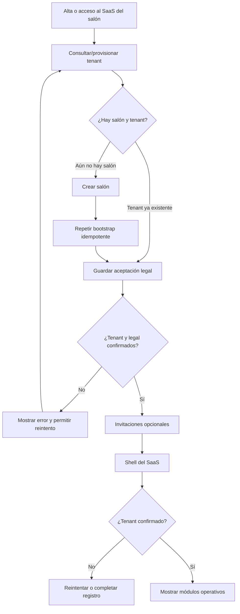

# Onboarding SaaS — Fase 1: puerta de entrada

**Estado:** cerrada según confirmación del usuario del 25 de noviembre de 2026. La entrada, provisión del tenant y reintento idempotente están desplegados y verificados con cuentas QA.
**Fecha de cierre:** 25 de noviembre de 2026.

## Objetivo

Impedir que el onboarding o una ruta directa de la app permitan operar el SaaS del salón sin un tenant SaaS confirmado. Permitir reintentar una provisión fallida aprovechando el bootstrap idempotente.

## Cambios realizados

- El alta de salón consulta primero el bootstrap SaaS. Solo intenta crear el salón cuando el backend confirma que el usuario aún no tiene uno.
- Tras crear el salón, vuelve a ejecutar el bootstrap idempotente. Si la respuesta del alta se perdió después de guardar el salón, se recupera el tenant existente en vez de insertar otro salón.
- Se eliminó la salida que completaba el onboarding y llevaba al hub sin tenant.
- La aceptación legal se guarda después de confirmar la provisión SaaS. Si falla, el usuario permanece en el formulario y puede reintentar sin recrear el salón.
- Los errores de provisión se muestran como bloqueos recuperables; las invitaciones siguen siendo opcionales y no bloquean la entrada.
- El shell `/salon` comprueba/provisiona el tenant antes de renderizar sus módulos. Si no puede, muestra reintento y acceso al formulario.
- La ruta directa `/salon/caja` reutiliza el shell y pasa por el mismo control de entrada.

## Flujo actualizado

## Validación y estado de publicación

- La suite de análisis y pruebas del proveedor pasó en GitHub Actions (workflow de verificación previa `45335504674`).
- El build web del proveedor pasó en el workflow de publicación `45336126415`.
- El deploy del job `Deploy glow_provider` terminó con éxito el 24 de noviembre de 2026.
- Producción: [GlowApp Proveedor](https://glowapp-provider.web.app/#/auth/onboarding). La raíz respondió HTTP 200 y el bundle servido contiene los textos de preparación SaaS y recuperación del registro.
- Código integrado en `main` mediante [PR #52](https://github.com/Diegoromerov/glowapp-firebase/pull/52), commit `34f8d185fa09ec4afec8a5c674e1a239af033371`.
- La recuperación de salones heredados conserva el plan válido de `salones.plan_saas`, aunque la app reintente enviando `FREE_TRIAL`; los planes heredados desconocidos se bloquean con conflicto explícito en vez de degradar la cuenta. Incluido en [PR #54](https://github.com/Diegoromerov/glowapp-firebase/pull/54), commit `c971e1005a90c665dba3f99b2fc108868a7c8785`.
- Las pruebas de ruta para conservar el plan y rechazar un código legado desconocido pasaron localmente y en el workflow Backend CI `45337648205`.
- Railway production: despliegue `15eb7a51-2af3-4ff7-b75f-39c5cb6addd1` terminó en `SUCCESS` para el commit `c971e10`. `/api/health` respondió HTTP 200, reportó PostgreSQL disponible y `servingFabricatedData: false`; `/api/saas/bootstrap` devuelve HTTP 401 sin credenciales.
- Se corrigió el caso en que el registro dejaba un `business_profile` preliminar sin salón: `findTenant` ahora exige que el perfil tenga una sede asociada, para que el onboarding pueda crear el salón en vez de saltar al shell sin sede. Incluido en [PR #56](https://github.com/Diegoromerov/glowapp-firebase/pull/56), commit `9a0d9df2bf59bb7723449b9fff565f0c249aa548`.
- La CI de PR #56 completó con éxito sintaxis, pruebas dirigidas, verificaciones RLS/aislamiento, contrato API e integración con PostgreSQL (`45338674240`). La suite dirigida local pasó 9/9.
- Railway production desplegó `9d4f6c44-55bc-479e-8ec2-c196d2e5f3af` en `SUCCESS` para `9a0d9df`. Verificación posterior: `/api/health` respondió HTTP 200, `env=production`, commit `9a0d9df2bf59bb7723449b9fff565f0c249aa548`, PostgreSQL disponible, `servingFabricatedData=false`, `memoryFallbackAllowed=false`; `/api/saas/bootstrap` sin token respondió 401.
- El análisis local no reportó errores de Dart; los diagnósticos restantes eran lint/estilo y deprecaciones.

## Verificación funcional en producción — 24 de noviembre de 2026

Se completó el recorrido con una cuenta de QA sintética, usando PostgreSQL de producción y la misma secuencia del onboarding:

1. Registro y autenticación del usuario proveedor.
2. Creación del salón con plan FREE_TRIAL.
3. Lectura de GET /api/saas/bootstrap: perfil salon-<id>, tenant tenant-<id>, rol OWNER.
4. Reintento de POST /api/saas/bootstrap: respuesta idempotente, created=false.
5. GET /api/saas/team: contexto SaaS resuelto, rol OWNER y membresía activa.
6. GET /api/salon/my-salon: salón y plan FREE_TRIAL presentes.

La primera ejecución reveló que RLS ocultaba business_profiles al usuario recién provisionado. Se corrigió con la política de lectura para proveedor o membresía ACTIVE en la migración 197, integrada por PR #60 y desplegada en Railway production. Después de la corrección, los seis pasos anteriores respondieron correctamente. El despliegue activo quedó en SUCCESS para el commit 4d6a89c21f10a5cfd02d688e72817054b1d31519. La comprobación de /api/health informó PostgreSQL disponible y sin fallback a datos inventados.

## Validación adicional en producción — 24 de noviembre de 2026

Después de publicar la idempotencia de creación del salón, se repitió el alta con una cuenta QA nueva:

1. Antes del alta, la cuenta no tenía salón asociado.
2. El primer `POST /api/salon/create` respondió HTTP 201, `created: true`, sede 11.
3. El reintento idéntico respondió HTTP 200, `created: false`, y devolvió la misma sede 11; no creó una segunda sede.
4. `GET /api/saas/bootstrap` respondió HTTP 200 con rol OWNER.
5. `GET /api/saas/team` respondió HTTP 200 con rol OWNER.
6. `GET /api/salon/my-salon` respondió HTTP 200 y devolvió la sede con el propietario activo.

La corrección del guard de membresía se desplegó en el commit `a8b833576877e9ac1878c14894027e3f15420378`. Tras el despliegue documental posterior, `/api/health` reportó commit `e1824d03763eb687b4bad3b6250a536fc5bc20e2`, `OK`, PostgreSQL disponible, sin datos fabricados y 69 migraciones registradas. El workflow de publicación del proveedor `45347597202` terminó exitosamente (análisis, compilación web y despliegue).

El shell confirma el tenant con el bootstrap antes de construir las pestañas; si falla, presenta reintento y no muestra módulos operativos. La ruta directa `/salon/caja` instancia el mismo shell con Caja seleccionada. Esta última verificación es inspección del código publicado, no una prueba visual automatizada en el navegador.

La validación funcional de Caja quedó completada por API: con una cuenta QA recién creada como propietaria, `POST /api/salon/create` respondió 201 para la sede 12, bootstrap y equipo devolvieron 200, y `GET /api/salon/12/caja/resumen` devolvió 200 con `mi_rol: DUEÑO` y alcance SALON. Una sesión autenticada sin membresía recibió 403 en Caja tras corregir el argumento de transacción en PR #65. Ambas lecturas fueron de solo lectura y no hubo movimientos financieros.

Las pruebas de producción crearon cuentas y sedes sintéticas. Durante una reproducción anterior al fix se generó una sede duplicada; los registros de QA no se eliminaron como parte de esta validación.

Comprobación adicional del despliegue activo: Firebase Hosting devolvió HTTP 200 para el onboarding y para `main.dart.js`; el bundle servido incluye el estado «Preparando tu espacio SaaS», el botón «Reintentar» y el mensaje de recuperación. Una solicitud sin autenticación a `GET /api/salon/11/caja/resumen`, con `X-App-Audience: provider`, devolvió HTTP 401 `Se requiere autenticación`. Después se probó con una cuenta QA autenticada y sin membresía: la primera petición reveló HTTP 500 porque `ownerGuard` llamaba a `runInTenantTransaction` con una firma incorrecta. Se corrigió en PR #65; Backend CI (run `45351069452`) pasó y Railway desplegó el commit `a8b833576877e9ac1878c14894027e3f15420378`. Al repetir la lectura de Caja, respondió HTTP 403 `No perteneces a este salón.` No se modificaron movimientos ni se accedió a los datos.

## Comprobaciones adicionales fuera del cierre

- Alta/reintento de una cuenta heredada con plan distinto de FREE_TRIAL.
- Recorrido visual adicional de rutas directas y de Caja en móvil/escritorio.

La ruta principal nueva de onboarding SaaS queda funcionalmente validada en producción y la fase se considera cerrada. Estos escenarios son verificaciones complementarias; no cambian el cierre acordado.
